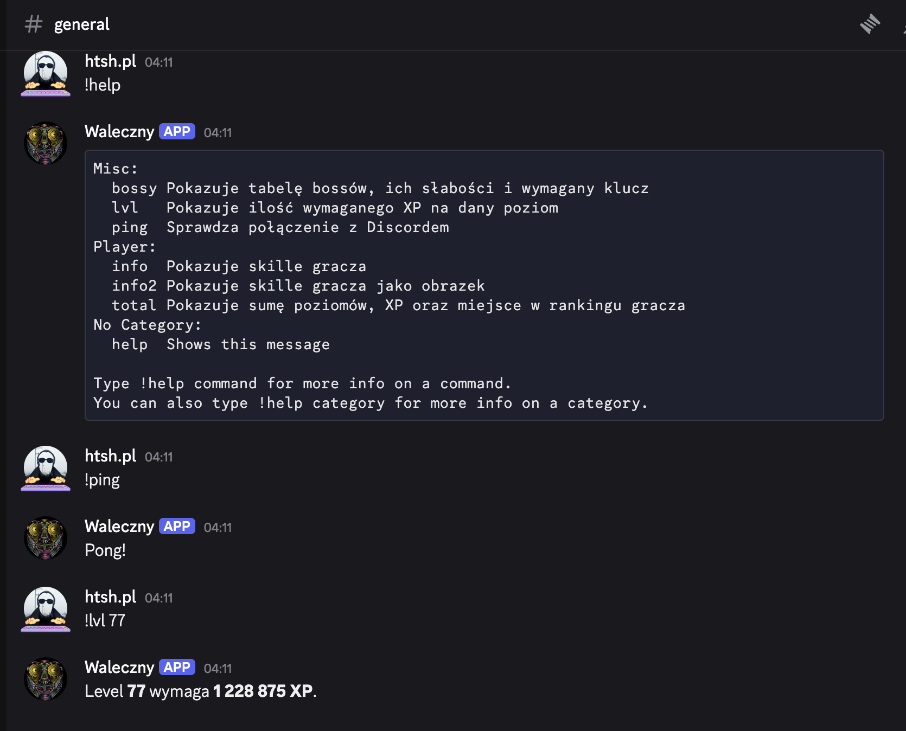
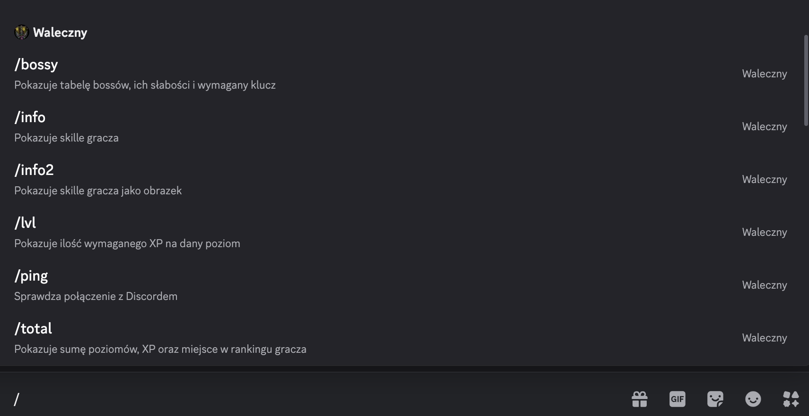

## PROBLEM

If you know basic Python and want a Discord bot that answers your own commands, this walks you from nothing to a bot running in a container. You register the bot, get `!ping` working from a single file, then move to slash commands split across files, and finally run it with Docker.

I built a bot like this for my old game clan: a handful of info commands for player stats, the XP needed for a level and boss weaknesses, which the clan still uses (the [IdleClans bot](/projects/idleclans-bot/)).

<div class="project-shots">
<picture><source srcset="/images/blog/discord-bot/ping-help-lvl.webp" type="image/webp"></picture>
</div>

## WHAT YOU NEED

- Python 3.10 or newer and a Discord account
- A Discord server for testing (create a throwaway one, it is free)
- Docker, only for the last section

## 1. REGISTER THE BOT IN THE DEVELOPER PORTAL

Discord calls your bot an "application". It has a name, a token (the password the bot logs in with) and a list of permissions. You create all of that on a web page.

1. Open the [Discord developer portal](https://discord.com/developers/applications) and click New Application. The name you pick becomes the bot's display name.
2. Open the Bot tab in the left menu. Click Reset Token and copy the token somewhere safe. Discord shows it only once, and you can reset it again if you lose it.
3. Scroll down to Privileged Gateway Intents and switch on Message Content Intent. Intents are switches that tell Discord which events your bot wants to receive. Without this one, the bot sees that a message was sent but not what it says, so it cannot read `!ping`.

The token is a password. Anyone who has it can control your bot. Never paste it into code, a screenshot or a chat, and if it leaks, reset it in the same place.

## 2. INVITE THE BOT TO YOUR SERVER

A bot is not in any server until someone invites it. You do that with a link that lists what the bot is allowed to do.

1. In the portal, open OAuth2 -> URL Generator.
2. Under Scopes tick `bot` and `applications.commands`. The first puts the bot in the server, the second lets it have slash commands. You only need the second one for the slash commands later in this post, but ticking both now saves you a re-invite.
3. Under Bot Permissions tick View Channels, Send Messages, Embed Links and Attach Files. That is enough for this post.
4. Copy the generated URL at the bottom, open it, pick your server and confirm. You need the Manage Server permission on that server to see it in the list.

The bot shows up in the member list as offline. That is expected, because no code is running yet.

## 3. VERSION 1: ONE FILE, TEXT COMMANDS

Make a folder with three files.

`requirements.txt`

```text
discord.py==2.7.1
python-dotenv==1.2.4
```

`.env` (never commit this file, add it to `.gitignore`)

```text
DISCORD_TOKEN=paste-your-token-here
```

`bot.py`

```python
import os

import discord
from discord.ext import commands
from dotenv import load_dotenv

load_dotenv()

intents = discord.Intents.default()
intents.message_content = True  # lets the bot read the text of messages

bot = commands.Bot(command_prefix="!", intents=intents)


@bot.event
async def on_ready():
    print(f"Logged in as {bot.user}")


@bot.command()
async def ping(ctx):
    await ctx.send("Pong!")


bot.run(os.environ["DISCORD_TOKEN"])
```

What each part does:

- `load_dotenv()` reads `.env` and puts `DISCORD_TOKEN` into the environment, so the token stays out of your code.
- `command_prefix="!"` means a message that starts with `!` is treated as a command.
- `@bot.command()` turns the function below it into a command named after the function, so `ping` becomes `!ping`. To add another command, write another function like it.
- `ctx` (short for context) describes where the command was used, and `ctx.send` replies in the same channel.

Run it:

```bash
python -m venv .venv
source .venv/bin/activate
pip install -r requirements.txt
python bot.py
```

You should see `Logged in as ...` and the bot turns green in the member list. Type `!ping` in a channel it can see, and it answers `Pong!`.

If it crashes with `PrivilegedIntentsRequired`, you skipped the Message Content Intent switch in step 1. If it says `Improper token`, the token in `.env` is wrong or has a stray space.

This is a complete bot, and for a small private server it can stay like this. Two things push people to the next version. One file gets long once you have ten commands. And text commands depend on that privileged Message Content switch, which Discord asks you to apply for once the bot is in 100 or more servers. Slash commands do not need it.

## 4. VERSION 2: SLASH COMMANDS IN SEPARATE FILES

Slash commands are the ones you type as `/ping`. Discord shows a menu with every command, its description and its arguments, so users do not have to remember syntax. In this version all the real commands are slash commands, and the only text command left is `!sync`.

The project now looks like this:

```text
my-bot/
  bot.py
  cogs/
    __init__.py
    general.py
    dice.py
  requirements.txt
  .env
```

A cog is a class that groups related commands, and each file in `cogs/` is loaded by the bot as an extension (discord.py's word for a plugin file). The main file only starts the bot and loads them.

`bot.py`

```python
import os
from typing import Literal, Optional

import discord
from discord.ext import commands
from dotenv import load_dotenv

load_dotenv()

EXTENSIONS = ["cogs.general", "cogs.dice"]

intents = discord.Intents.default()
intents.message_content = True  # only needed for the !sync text command


class MyBot(commands.Bot):
    async def setup_hook(self):
        for name in EXTENSIONS:
            await self.load_extension(name)


bot = MyBot(command_prefix="!", intents=intents)


@bot.event
async def on_ready():
    print(f"Logged in as {bot.user}")


@bot.command()
@commands.is_owner()
async def sync(
    ctx: commands.Context,
    scope: Optional[Literal["all", "clear"]] = None,
):
    if scope == "all":
        synced = await bot.tree.sync()
        where = "all servers"
    elif scope == "clear":
        bot.tree.clear_commands(guild=ctx.guild)
        synced = await bot.tree.sync(guild=ctx.guild)
        where = "this server cleared"
    else:
        bot.tree.copy_global_to(guild=ctx.guild)
        synced = await bot.tree.sync(guild=ctx.guild)
        where = "this server"
    await ctx.send(f"Synced {len(synced)} commands ({where}).")


bot.run(os.environ["DISCORD_TOKEN"])
```

`cogs/general.py`

```python
import discord
from discord import app_commands
from discord.ext import commands


class General(commands.Cog):
    def __init__(self, bot: commands.Bot):
        self.bot = bot

    @app_commands.command(name="ping", description="Check the bot is alive")
    async def ping(self, interaction: discord.Interaction):
        latency = round(self.bot.latency * 1000)
        await interaction.response.send_message(f"Pong! {latency} ms")


async def setup(bot: commands.Bot):
    await bot.add_cog(General(bot))
```

`cogs/dice.py`

```python
import random

import discord
from discord import app_commands
from discord.ext import commands


class Dice(commands.Cog):
    @app_commands.command(name="roll", description="Roll a dice")
    @app_commands.describe(sides="How many sides the dice has")
    async def roll(
        self,
        interaction: discord.Interaction,
        sides: app_commands.Range[int, 2, 1000] = 6,
    ):
        result = random.randint(1, sides)
        message = f"You rolled {result} (d{sides})"
        await interaction.response.send_message(message)


async def setup(bot: commands.Bot):
    await bot.add_cog(Dice())
```

Things that changed compared to version 1:

- A slash command receives an `interaction` instead of `ctx`, and you answer with `interaction.response.send_message`.
- The arguments become form fields in Discord. `sides` is a number between 2 and 1000 with a default of 6, and Discord rejects anything else before your code runs.
- Each file ends with a `setup` function. That is what `load_extension` calls to hand your cog to the bot. Adding a new file of commands means writing it and adding its name to `EXTENSIONS`.
- Cogs are plain Python files, so there is nothing to register by hand besides that list.

### WHY /PING DOES NOT SHOW UP YET

Start the bot and type `/`. Your commands are not there. That is not a bug.

Slash commands live on Discord's side. Discord keeps its own list of what your bot offers, and your code only holds the definitions. Until you upload the list, Discord does not know `/ping` exists. Uploading is called syncing. It is a separate step on purpose, because syncing on every start would hit rate limits and slow startup. You sync once, and again only when you add, remove or rename a command or change its arguments. Changing what a command does inside does not need a sync.

That also explains why `sync` is a text command: the first sync has to happen before any slash command exists, so it cannot be one itself. It is restricted with `is_owner()`, so only the person who owns the bot application can use it.

One word you will see everywhere in the Discord API is "guild". A guild is just Discord's internal name for a server, the thing in your left sidebar. The docs and the library say guild, the app says server, and they mean the same thing.

In your test server, type:

- `!sync` - uploads the commands to this server only. They appear right away, so this is the one to use while developing.
- `!sync all` - uploads them globally, for every server the bot is in. Global changes can take a while to show up everywhere.
- `!sync clear` - removes this server's copy of the commands. Use it after a global sync, otherwise this server shows every command twice.

After `!sync`, type `/` again and you will see `/ping` and `/roll` with their descriptions.

<div class="project-shots">
<picture><source srcset="/images/blog/discord-bot/slash-commands.webp" type="image/webp"></picture>
</div>

If you would rather not use the privileged Message Content switch at all, change the prefix to `commands.when_mentioned`. Then you run sync by mentioning the bot (`@YourBot sync`, `@YourBot sync all`), and Discord lets bots read messages that mention them without the intent. You can then turn the intent off in the portal and delete the `intents.message_content` line.

## 5. RUN IT IN DOCKER

Running `python bot.py` in a terminal works until you close the laptop. A container gives you a bot that starts on boot and restarts after a crash, on any machine with Docker, with the same Python version every time. This works for both versions, since it just runs `bot.py`.

`Dockerfile`

```dockerfile
FROM python:3.12-slim

ENV PYTHONUNBUFFERED=1
WORKDIR /app

COPY requirements.txt .
RUN pip install --no-cache-dir -r requirements.txt

RUN useradd --create-home app
COPY --chown=app:app . .
USER app

CMD ["python", "bot.py"]
```

`.dockerignore`

```text
.env
.git
__pycache__/
.venv/
```

Line by line:

- `python:3.12-slim` is a small Linux image that already has Python installed.
- `PYTHONUNBUFFERED=1` makes print output show up immediately in `docker logs`. Without it, Python holds output back and the log looks empty.
- Copying `requirements.txt` and installing before copying the rest means Docker reuses the cached install step when you only change your code. Rebuilds take seconds instead of a minute.
- `useradd` and `USER app` run the bot as a normal user instead of root, so a bug in the bot does not get root inside the container.
- `.dockerignore` keeps `.env` out of the image. Anything copied into an image can be read by anyone who gets the image, so the token must never be baked in.

The token is handed over when the container starts instead:

```bash
docker build -t my-bot .
docker run -d --name my-bot --restart unless-stopped --env-file .env my-bot
docker logs -f my-bot
```

- `-d` runs it in the background.
- `--restart unless-stopped` brings it back after a crash or a reboot, and leaves it alone if you stopped it yourself.
- `--env-file .env` passes the variables from `.env` into the container at runtime.

To update the bot after changing code, rebuild and replace the container:

```bash
docker build -t my-bot .
docker rm -f my-bot
docker run -d --name my-bot --restart unless-stopped --env-file .env my-bot
```

## TROUBLESHOOTING

- **The bot answers every message twice.** Two copies are running with the same token, for example one on your laptop and one in a container. Discord does not stop you, both connect and both reply. Stop one of them. This bit me during testing.
- **`/ping` does not appear.** Run `!sync` first. If that fails, check that you invited the bot with the `applications.commands` scope in step 2, and re-invite it if not.
- **`!sync` does nothing.** Only the owner of the bot application can run it, and the bot needs the Message Content Intent switch on, or the mention prefix from the end of section 4.
- **Commands show up twice in your test server.** You ran both `!sync` and `!sync all`. Run `!sync clear` here and keep the global copy.
- **The bot is online but ignores `!ping`.** Check the Message Content Intent switch, and that the bot can see the channel and send messages there.
- **You pasted the token somewhere public.** Reset it in the Bot tab. The old one stops working immediately.

## WHERE TO GO NEXT

From here the pattern repeats: write a function, decorate it as a command, add the file to `EXTENSIONS`, sync when the list of commands changes. For anything that calls a web API, use an async HTTP client such as `aiohttp` with a timeout, because a blocking call freezes the whole bot, including its connection to Discord.
