I'm building my own Tamagotchi-style pet, the kind of toy kids carried around in Poland in the mid 2000s, and this first post covers the half that needs no soldering: a pet that hatches, grows, gets sick and can die, all inside a window on my computer.

If you can read a little C and like retro gadgets, you'll see how these toys work, where I dug up the rules I had forgotten, and how I decided what fits on a screen of 32x16 pixels. By the end you'll know every stage of the pet's life and exactly what keeps it alive.

## WHERE THIS COMES FROM

When I was at school, everyone had one of these. Mine was almost certainly a cheap knockoff, because back then everything was a copy of something, so I can't even tell you what it was really called. What I remember is the routine.

- You picked an animal at the start. A cat, a dog, and maybe something else like rabbit or so.
- You picked a gender too.
- You started with an egg that took about a day to hatch.
- After hatching it went through a few toddler stages and ended up as an adult animal.
- It followed the clock like you did. In the morning you took a peek, cleaned its room of poop, fed it, and petted it until the hunger and happiness bars filled up.
- If you ignored it for a day or two it got sick and died.
- When it died you got a little grave with the number of days it had survived, and the only way forward was a hidden reset button in a tiny hole in the case, which you had to press with a needle.

That last detail is the one I never forgot. You couldn't just press "try again" - you had to go find a needle and admit that it was over.

## THE PLAN: EMULATOR FIRST, HARDWARE LATER

I've wanted a hardware pet project for a while, something small where I can play with a microcontroller, a small display and a few buttons. A Tamagotchi is a good excuse, because the original was a very small computer doing a very simple job. So the project has two stages.

- Stage 1: the pet as a program on my computer, with the same tiny screen and three buttons, shown in a window.
- Stage 2: a real device, around 7x5x2 cm, that I can carry around. That's for the next posts.

Doing the emulator first is deliberate. Rules like "how fast does it get hungry" are much easier to tune when I can run a whole pet life in a few seconds than when I'm waiting on hardware. The one rule I set for myself: the part that decides how the pet behaves must not know anything about the window, so the exact same code can later run on the chip.

The repo is called [temugotchi](https://github.com/krzlew/temugotchi/), after the meme: "Mom, can I have a Tamagotchi?" "We have a Tamagotchi at home." This is the one at home.

I'm writing this together with an AI coding assistant, which wrote most of the code while I made the design calls and played with the result. I'll show a few of the mistakes along the way.

## FILLING THE GAPS IN MY MEMORY

Twenty years is a long time, and my toy was a copy anyway, so I went looking for how the real ones behaved.

- The [Tamagotchi page on Mental Floss](https://www.mentalfloss.com/fun/toys/tamagotchi-history) confirmed the part I remembered best: a dead pet is gone for good, and the reset button was recessed so you needed something thin to press it.
- [tama.loociano.com](http://tama.loociano.com/) lists the hardware of the original: a 4-bit Epson chip running at 32.768 kHz with 640 words of 4-bit RAM. That is roughly 320 bytes of working memory for the whole toy, which makes me feel much better about my own memory budget later.
- A [fan-written evolution guide on Tamatalk](https://tamatalk.com/goto/post?id=3382254) explained that the adult you get depends on how many "care mistakes" you made, not just on time.
- A [university student project about the toy](https://cctp506m.github.io/tamagotchi/) listed the actions I had half forgotten: besides feeding and cleaning there was medicine, turning the light off at night, and a discipline button.
- A scan of an original manual that I found showed the control layout: three buttons called A, B and C, with a row of small icons above and below the screen. It also had a growth chart with the five stages: egg, baby, child, teenager, adult.

The most useful find was [tamatama](https://github.com/lowlevel-1989/tamatama), a project that reverse-engineered the game logic of an Android version of the toy from 2013. Its documentation has the actual numbers: how many minutes per heart, how often it poops, how long you have to answer before it counts as neglect, when it dies.

It's a close port of the original, not a dump of the 1996 hardware, and my school toy was a knockoff of something else again. So when I say "the toy did X" below, read it as "this well-documented version did X". I took the 5-minute hatching time from a search summary and could not confirm it, and the Android version hatches almost instantly, so treat that one as a guess.

It also turned out that the numbers are faster than what I remembered. I remembered a day to hatch, and the documented version needs about 5 minutes. I went with the documented numbers, and I'll show at the end that a neglected pet still dies on about the timescale I remembered.

## FROM MEMORY TO DESIGN

### A SCREEN OF 32X16 PIXELS

I decided on one hard limit early: the screen is 32 pixels wide and 16 pixels tall, one color. That is what I believe the original had, and one source lists a slightly taller screen for a later model, so I'm not claiming it's exact. The point is that a frame of 32x16 one-bit pixels is just 64 bytes, so the same picture will fit on a tiny chip with room to spare. It also stops me from drawing anything fancy, which is exactly the look I want.

The original also had icons that aren't pixels at all. They are fixed shapes printed on the glass that light up or not, in a row above and below the pixel area. I copied that layout. My top row is feed, pet, clean and medicine. The bottom row is lights, discipline, status and an attention bell. Three buttons drive everything: A moves along the icons, B confirms, C cancels.

### THE BRAIN AND THE WINDOW ARE SEPARATE

The code that decides how the pet behaves is a single C file with three functions, and it never touches the window.

```c
// time passes
void pet_tick(Pet *p, uint32_t seconds);
// a button was pressed
void pet_button(Pet *p, uint8_t btn);
// give me the 32x16 picture
void pet_render(const Pet *p, Frame *f);
```

The window program just calls these and draws the result. On the real device, a chip will call exactly the same three functions. The whole state of a pet is 64 bytes.

### DRAWING PIXELS AS TEXT

I draw the little pictures (game people call them sprites) as text, where `#` is a lit pixel, and a small script turns them into C arrays. This is my egg:

```text
......####......
.....#....#.....
....#......#....
...#........#...
...#...#....#...
..#..........#..
..#.......#..#..
..#..........#..
..#...#......#..
..#..........#..
...#........#...
...#........#...
....#......#....
.....######.....
```

Editing a sprite is now just editing text, and the script refuses a row with the wrong width.

### FACES, SO THE PET CAN HAVE A MOOD

My first sprites had the face drawn into each body. That meant a happy cat and a sad cat would need two different drawings, for every animal at every age. So I split them: bodies have no face, and there are four small shared faces drawn on top at a spot defined for each body.

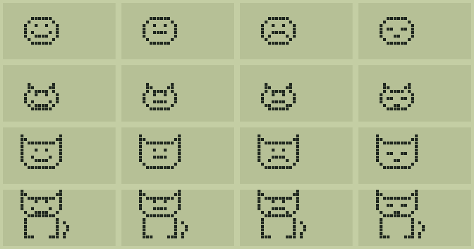

The face depends on simple rules. Happy means both hearts are full and the room is clean. Sad means either heart is low, there are two or more poops, or it's sick. Anything in between is neutral, and a sleeping pet has closed eyes.

### THREE ANIMALS, THREE PERSONALITIES

The source game has many characters with different needs, so I gave each of my animals a personality borrowed from them. The cat is balanced. The dog is needy: it gets hungry faster, gets sick more often, and needs two doses of medicine as an adult. The dragon is hardy and almost never needs medicine.

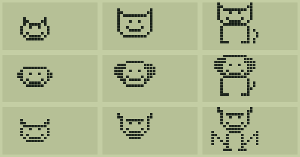

I tested this by simulating lives with a perfect caretaker. A dog needs about 12 feedings and over one medicine press per day as an adult, a dragon about 9 feedings and almost no medicine. The cat is the one who needs scolding the most, about twice a day.

## HOW TIME WORKS

Everything counts in game minutes that pass while the pet is awake. These are the numbers from the documented version.

- The egg hatches 5 minutes after you set the clock (my guess, as explained above).
- The baby stage lasts 60 minutes.
- The child grows up after 2 mornings, the teen after 3 more. The exact moment is random during that day.
- Hunger and happiness are 0 to 4 hearts. A heart is lost every 7 minutes as a baby, 55 as a child, 80 as a teen, and about 86 as an adult.
- Poop appears every 3 awake hours.
- Children sleep from 20:00 to 09:00, teens from 21:00, adults from 22:00, and nothing gets worse while they sleep.

## A PET'S LIFE, STEP BY STEP

Here is what it looks like when I run it. The keys are Z, X and C for the buttons A, B and C, and the number keys 1 to 4 speed up time from normal to one hour per second, which is how I test a whole life in a few minutes.

### STARTING A NEW PET

First I pick the animal with A and confirm with B.

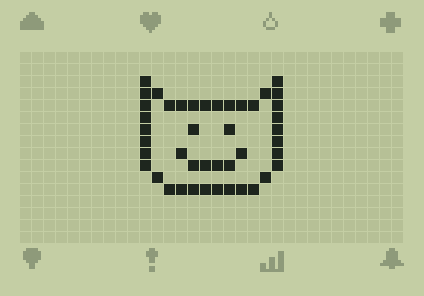

Then the gender. It only changes the small F or M symbol right now, and has no effect on the game yet.

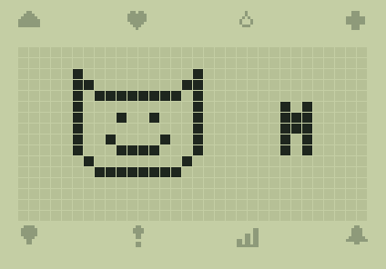

Then I set the clock to the real hour. This matters, because the pet's night follows my night.

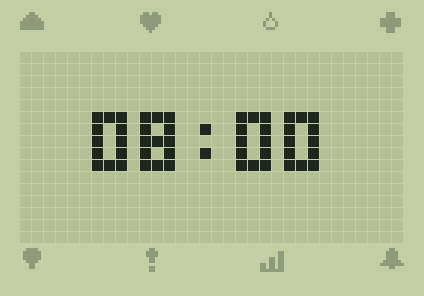

My first version showed a `!` here as a stand-in for the colon, and it looked like an alarm. I only noticed when it confused me while playing.

### THE EGG

Then there's nothing to do for 5 minutes (my guess for the hatching time), and the egg starts to wobble in the last minute before it hatches.

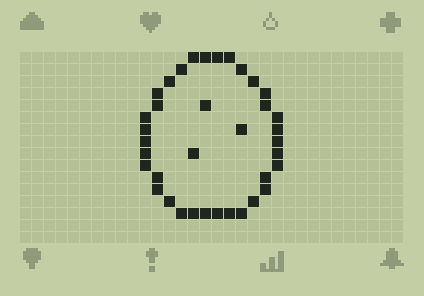

### THE BABY

The baby needs attention often, because a heart disappears every 7 minutes, but it's forgiving. Its calls only last 2 minutes and never count against you. It grows into a child after an hour.

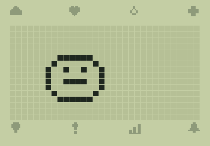

### THE ROUTINE

From the child stage on, the routine is what I remember from school. A heart takes 55 minutes to disappear, so a full pet is empty in about 3.7 hours, and the room gets one more poop every 3 hours. In practice that means checking in every couple of hours during the day: feed, pet, clean.

To act, I press A to move along the icons until the one I want is lit, and B to use it. When it works, the icon shows up next to the pet for a few seconds.

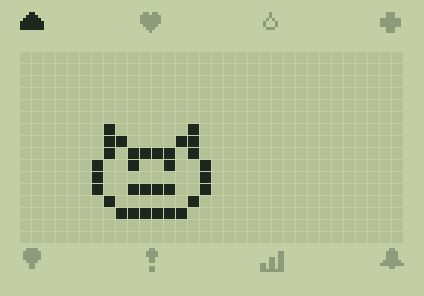

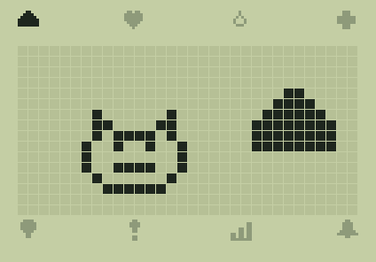

I played the first version without that feedback, and I couldn't tell whether anything had happened. The status screen shows the exact values: two rows of four boxes, food icon for hunger and heart icon for happiness, one box per heart. Without the icons I had no idea which row was which.

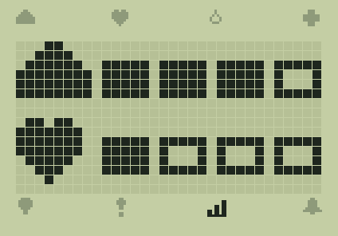

### WHEN THE PET ASKS FOR SOMETHING

The attention bell at the bottom right lights up when something needs me. Calling is how the game punishes neglect. When a heart hits zero, I have 15 minutes to answer, and if I miss it, it counts as a care mistake. Those mistakes decide what kind of adult it becomes: fewer than 3 care mistakes and fewer than 2 discipline mistakes during the teen years give the good version, and anything worse gives a grumpier one.

A pet that misbehaves shows a `!`. I have 30 minutes to scold it with the discipline icon, and until then it refuses to eat.

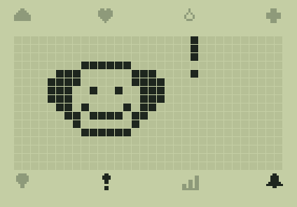

A sick pet shows a `+` in the corner and needs one or two doses of medicine. Pets get sick when there are eight poops in the room, or at random every day or two.

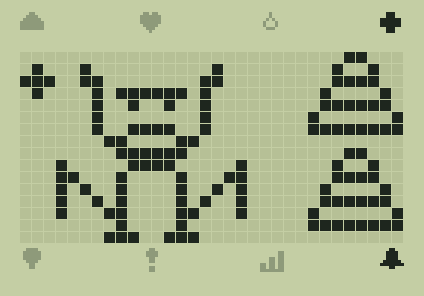

### BEDTIME

At bedtime (20:00 for a child, 21:00 for a teen, 22:00 for an adult) the pet falls asleep. A little Z shows up and the bell lights, because it wants the light off.

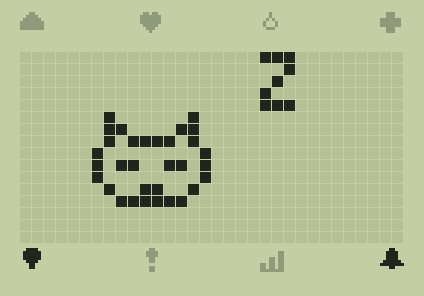

I have 60 minutes to press the lights icon. The screen goes dark, and the mistake is avoided. In the morning, at 09:00, the lights come back on by themselves.

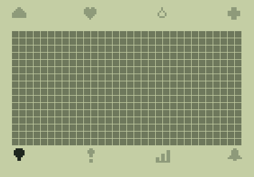

### GROWING UP

The child becomes a teen after two mornings, the teen an adult after three more. A pet that I looked after perfectly is an adult after about five and a half days, and it stays an adult for as long as I keep looking after it. The documentation I found doesn't mention dying of old age, so in my version there is none.

### HOW A PET DIES

There are three ways, and the first two only count the time the pet is awake.

- It has been at zero hunger hearts for 12 hours.
- It has been sick for 6 hours without medicine.
- It gets sick for the third time in one stage.

If I never touch a pet, it dies about 26 hours after hatching. That matches the "a day or two" I remembered from school, and a test keeps it between 24 and 48 hours.

When it dies, I get the grave with the number of days it lived.

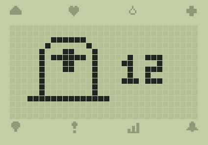

The buttons stop working. To start again I hold the R key for a second and a half, my version of the needle.

## THINGS THAT WENT WRONG

Two stumbles:

- The first poop sprite looked like a black triangle. The second try is an outlined swirl, which is recognizably what it is.
- I wrote a rule that the third sickness in a life stage is fatal. Adults never leave their stage, so even a perfect owner's pet died within five to fourteen days of becoming an adult, depending on the animal. I found it only by simulating a few dozen lives, and fixed it by resetting an adult's count every morning.

## WHAT'S NEXT

The pet works, and the part that decides how it behaves is about 700 lines of C. The next posts are about the real thing: picking a chip, a screen and buttons, how a device with no wall socket keeps track of time while it's switched off, saving a pet to survive a battery change, and building a 7x5x2 cm egg to put it in. I also still owe the egg something to do while it waits, and the dragon needs better wings.

If you want to try it yourself, clone [krzlew/temugotchi](https://github.com/krzlew/temugotchi/) and run these. You need `make`, a C compiler and SDL2 for the window. `make test` needs no SDL2.

```bash
make
make run
make test
```
