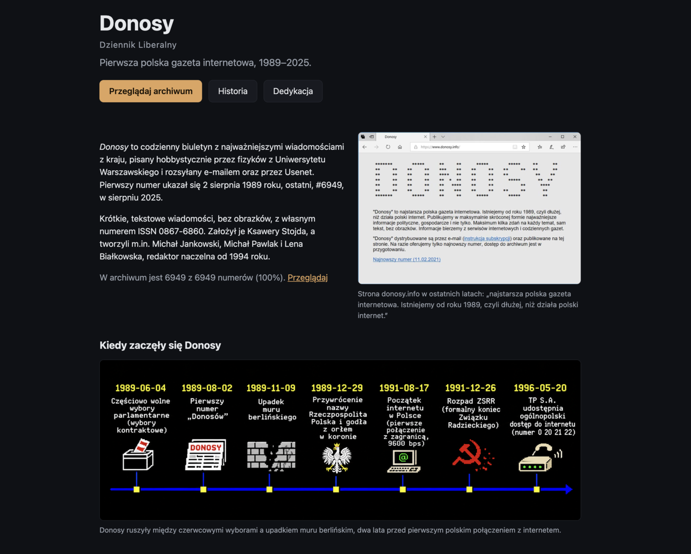
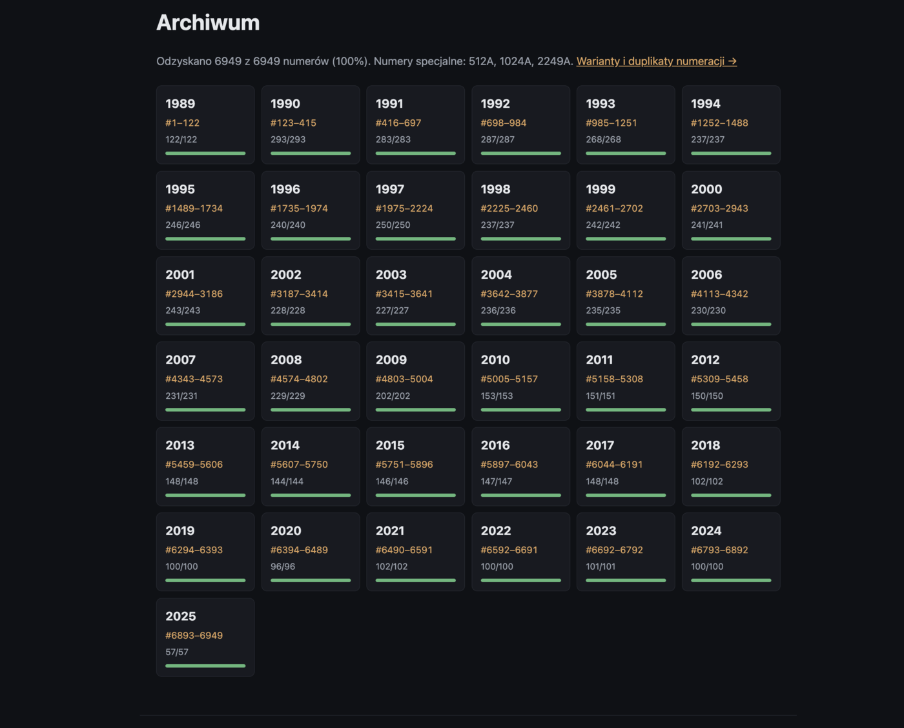
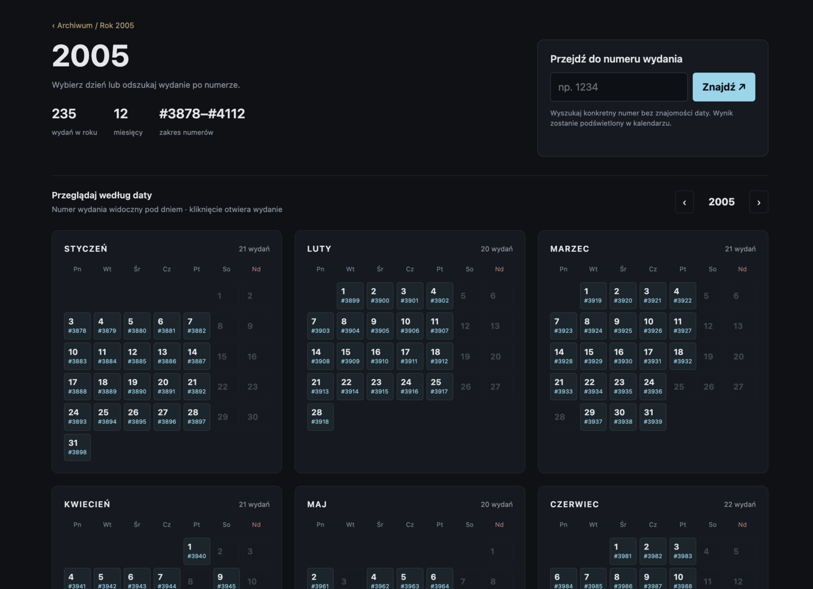
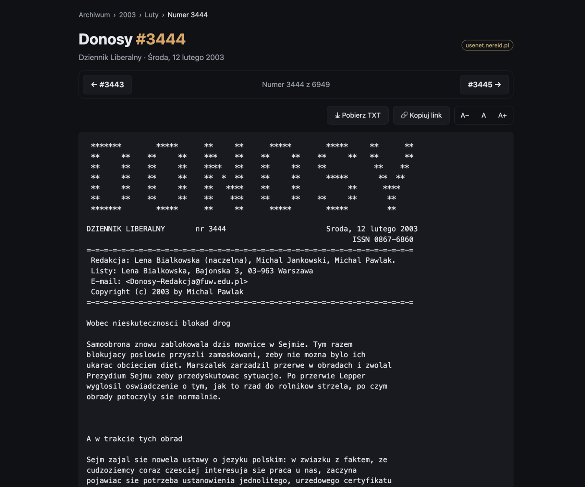

While clicking through newsgroups in galaxy-web, a web reader for Usenet archives (see the [previous tidbit](/tidbits/usenet-archive-galaxy-web/)), I ran into `pl.gazety.donosy`. It brought back memories of subscribing to Donosy, a daily newsletter with the main Polish and world news. These days I get something similar from [infopigula.pl](https://infopigula.pl). The first message in that group's archive is "Donosy #1705", dated 1995-11-19. That means 1704 issues came out before the group existed, and I wanted to know where they were. Eventually I found them all, and the archive now has every one of the 6949 issues.

## WHAT DONOSY WAS

*Donosy. Dziennik Liberalny* was a daily bulletin of domestic Polish news, written as a hobby by physicists at the University of Warsaw and founded by Ksawery Stojda. The first issue went out on 2 August 1989, which also made it into the [ICM timeline of Polish internet history](http://kalendarium.icm.edu.pl/). Donosy first travelled over BITNET and DECnet, two early academic computer networks. Over the years it was also distributed through a mailing list and Usenet, it got an ISSN (0867-6860) in 1991, and it kept coming out until issue #6949 in August 2025. More in the [Polish Wikipedia article](https://pl.wikipedia.org/wiki/Donosy._Dziennik_liberalny).

Issue #1 is a few lines of 1989 political humour: the First Secretary becomes President, the Premier becomes First Secretary, the Minister of Internal Affairs becomes Premier. It is signed "XS".

## WHERE THE ISSUES CAME FROM

No single place has all of them, so the archive is stitched together from several sources:
- #1 to #1704 (1989 to November 1995): the old Physics Department web archive at fuw.edu.pl
- #1705 to #5402 (November 1995 to August 2012): the `pl.gazety.donosy` group from usenet.nereid.pl, with the 203 issues that never reached Usenet filled in from fuw.edu.pl
- #5403 to #6191 (August 2012 to December 2017): the public web archive (pipermail) of the `donosy-l` mailing list
- #6192 to #6949 (2018 to August 2025): the mail archive of Robert Obryk, a Donosy subscriber, with the last 18 issues filled in with help from one of the authors, Jerzy Michał Pawlak (more below)

The mailing list years are plain ASCII with no Polish diacritics, which is how the originals were sent. A few issues looked like duplicates and turned out to be typos in the issue number. The odd ones out are #6122 and #6123, which each went out twice. Since the dates fit, I saved the second pair as #6124 and #6125.

## CLOSING THE GAP AFTER 2017

In 2018 Donosy moved to its own site, donosy.info, after being "politely" asked to leave the network of the Faculty of Physics at the University of Warsaw (FUW). When the site disappeared it left no public archive. Its DNS no longer resolves, and the Internet Archive's Wayback Machine only crawled the page with the current issue, so at first I could recover just 122 of the 758 issues from 2018 to 2025.

Then Robert Obryk, who had subscribed to Donosy, sent me his mail archive. It covered 2018 to 2025 and left only 18 issues missing. I wrote to Jerzy Michał Pawlak, one of the authors, and he helped cover the last gaps. That took the 2018 to 2025 years from 122 of 758 issues to all of them, and the archive now has all 6949 numbered issues, plus three special ones (512A, 1024A and 2249A). Thanks to both of them.

## THE VIEWER

To read the archive I put together a static viewer, with a landing page about the history of Donosy.

<picture><source srcset="/images/tidbits/donosy/home.webp" type="image/webp"></picture>
<picture><source srcset="/images/tidbits/donosy/year-grid.webp" type="image/webp"></picture>
<picture><source srcset="/images/tidbits/donosy/year-2005.webp" type="image/webp"></picture>
<picture><source srcset="/images/tidbits/donosy/issue-3444.webp" type="image/webp"></picture>

How the web viewer looks now. It is still in progress. Click to enlarge.

## NOT PUBLIC, YET

The archive still isn't public because of copyright. Jerzy Michał Pawlak and I are now working on a way to share it properly.

The archive is dedicated to everyone who wrote Donosy, and to Helena "Lena" Białkowska in particular. She was editor-in-chief from 1994 and a physics professor at the National Centre for Nuclear Research, and she died on 26 December 2025, a few months after the last issue. ([NCBJ notice](https://www.ncbj.gov.pl/en/late-prof-helena-bialkowska-passed-away))
